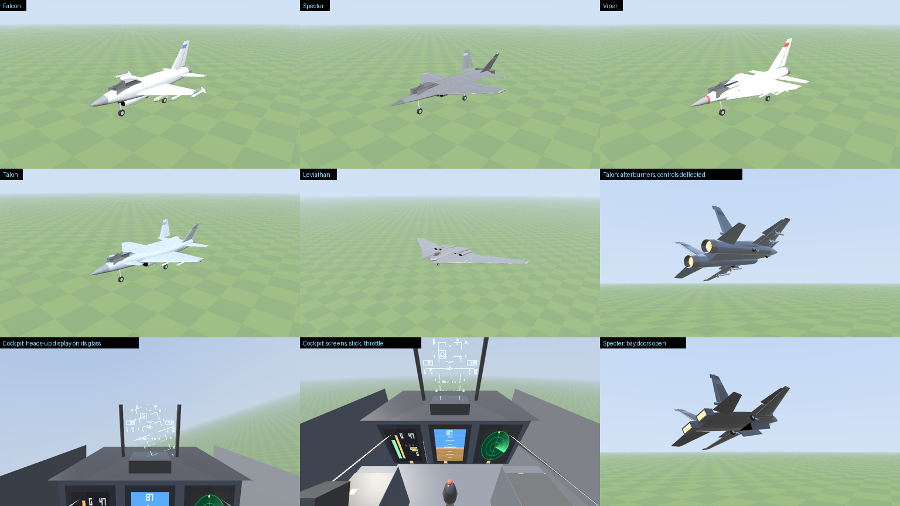

# Superpowers

A native mod for [Horizon](https://github.com/horizon-rust/horizon), the Rust rewrite of Minecraft: Java Edition
26.3. It adds twelve super powers, five of them mega powers, plus elytra-style **Superflight** with barrel rolls and
loops. On top of that there's the **CATACLYSM**, a crater 40 chunks across, two items (the **Storm Scepter**, which
calls down 13 disasters, and a **Gravity Gun**), **five fully simulated jets** with cockpits and weapons, a keybind
panel and aurora night skies. Made for **Horizon Nightly 2026-11-19** (`f00125f`) and the new launcher, which reads
native mods from `horizon-mod.toml`.

*Drawn on a software GPU over a stand-in scene (the grass and stone pillars are fake) by this mod's effects. In
the game they draw over your world.*

## Powers

All keys can be rebound in Horizon's Controls, under **Superpowers**. **H** shows and hides the panel, which lists
every key, cooldown and the laser power.

| Key | Power | What it does |
| --- | --- | --- |
| **Z** | Super Punch | Shatters a cone of blocks 16 long. Debris flies, mobs are hurt and thrown, and a shockwave races across the ground. |
| **G** | Laser Eyes | Toggles the beams. **Each right-click raises the power from 1 to 5**, then wraps back to 1. They burn through blocks and set mobs alight. |
| **V** | Thunder Strike | Seven lightning bolts strike around your target. |
| **B** | Frost Nova | Water freezes, lava turns to obsidian and snow settles within 14 blocks. Mobs are frozen and slowed. |
| **N** | Gravity Well | A black hole pulls in mobs, items and torn-up blocks for 5 seconds, then implodes. |
| **J** | Hyper Dash | Launches you forward, with a rainbow trail and a sonic boom. |
| **R** | **Superflight** | Fly freely, steering with the mouse, as with an elytra but with no gliding (see below). |

### Mega powers (×5)

| Key | Power | What it does |
| --- | --- | --- |
| **Y** | Titan Fist | Super Punch ×5: a cone 80 blocks long and a shockwave 170 blocks out. |
| **U** | Omega Beam | Laser Eyes ×5: a giant beam that carves a tunnel 200 blocks long for 4 seconds, following your aim. |
| **I** | Wrath of the Gods | Thunder ×5: 36 bolts across a circle 92 blocks wide, each leaving a crater. |
| **O** | Absolute Zero | Frost ×5: freezes 70 blocks round you, raises ice spikes and adds a blizzard of frost. |
| **K** | Singularity | Gravity Well ×5: a black hole that pulls from 120 blocks away, eats a ball of land 48 blocks across, then explodes. |
| **M** (hold 2 s) | **CATACLYSM** | Hold to charge, aim where you look, and let it build. It blasts a crater **640 blocks (40 chunks) across** and up to 90 deep, wiping out everything in it. Let go early to call it off. |

## Items

*Drawn on a software GPU over a flat stand-in scene. In the game they draw over your world, and the blocks they
throw, the craters, the water and the lava are real.*

Type **`/superpowers give`** in chat to get both. They are a breeze rod and an echo shard with new names: any breeze
rod or echo shard works.

### Storm Scepter (breeze rod)

| Control | Does |
| --- | --- |
| Right-click | Calls the chosen event down wherever your cursor points, as far as the world is drawn (up to 1024 blocks). A ring on the ground shows where and how big. |
| Hold **R** | Opens the picker (R doesn't toggle flight while you hold the scepter). **Scroll** or **A / D** to choose, let go of R to keep it. |

| Event | What it does to the world |
| --- | --- |
| **EF1 Tornado** | A rope funnel wanders across the land for 20 s, stripping leaves, grass and flowers. |
| **EF2 Tornado** | Snaps trees and tears up wooden buildings and glass. |
| **EF3 Tornado** | Also scours the soil from its path. |
| **EF4 Tornado** | A wide funnel that flattens anything wooden and scours deeper. |
| **EF5 Tornado** | 38 blocks wide; grinds its path down to bare stone. Lightning flickers in its wall cloud. Every tornado flings debris blocks and sucks in mobs. |
| **Hurricane** | A spiral cloud deck 280 blocks across with a calm eye. Rain, lightning, wind that strips the land and throws mobs, and a storm surge that floods low ground. |
| **Tsunami** | A 28-block wave 150 wide rises at the cursor and rolls at **you**, sweeping away trees, buildings and mobs, and breaks just short of you. It leaves real water behind. |
| **Flood** | Rain, then the water rises 9 blocks over a 48-block radius, filling the low ground and leaving a lake. |
| **Solar Flare** | A column of the sun's fire reaches the ground. Water boils away, snow and ice melt, sand turns to glass, rock melts to magma and fires start. |
| **Nuke** | A flash, a fireball, a shockwave and a mushroom cloud 150 blocks tall. It leaves a crater 88 blocks across, flattens and burns the land out to 150 blocks, and the sound arrives late. |
| **Meteor** | A fireball streaks in from the sky, blasts a 34-block crater with ejecta flying out, and leaves a glowing meteorite of ancient debris and magma at the bottom. |
| **Earthquake** | The ground splits along jagged faults up to 90 blocks long and 26 deep, lava at the bottom of the widest, while blocks tumble and the camera shakes hard. |
| **Volcano** | A mountain 42 blocks tall and 80 across rises out of the ground, its crater fills with lava that spills down its sides, and it erupts lava bombs under a column of ash with lightning in it. |

### Gravity Gun (echo shard)

| Control | Does |
| --- | --- |
| Right-click | Doubles the size of what it picks: 1, 2, 4, 8 blocks across, then back to 1. A glowing box shows the cube. |
| Left-click | Rips that cube out of the world. The blocks float in front of you and follow your aim. |
| Left-click again | Flings them where you look. They hurt what they hit and land as blocks. |
| Right-click while holding | Lets them drop. |

## Jets

*Drawn on a software GPU over a stand-in scene. In the game they fly in your world.*

**Tap P** to get in (on the ground the jet stands on its wheels; in the air it is already flying) and again
to get out. **Hold P** to choose a jet: scroll or A/D, then let go. **F5** switches between the cockpit and the
chase camera.

| Jet | What it is |
| --- | --- |
| **Falcon** | Light fighter: balanced and easy. Cannon, 4 missiles, 2 bombs. |
| **Specter** | Stealth fighter: faceted, dark, no afterburner flame. Missiles fire from bay doors in its belly. |
| **Viper** | Delta-wing interceptor: fastest in a straight line, wide turns. 6 missiles. |
| **Talon** | Thrust-vectoring dogfighter with canards: the tightest turns, and **C** does a Cobra. |
| **Leviathan** | Flying-wing bomber, 52 blocks across: slow and heavy; middle click opens the bay and drops a stick of 20 bombs. |

**The flight model is a real simulation.** Every wing half, tailplane, fin and canard makes its own lift and
drag from the air it meets (including the air from the jet's own rotation), with a lift curve that stalls.
Thrust, gravity, body drag that rises near the speed of sound, thinner air up high, and landing gear on springs
do the rest. Nothing is scripted: stability, stalls, spins, energy lost in turns, takeoffs and landings all come
out of the forces.

| Control | Does |
| --- | --- |
| Mouse | **Mouse aim** (default): the fly-by-wire points the nose where you look. **Direct** (`;`): the mouse is the stick, the view stays fixed to the cockpit. |
| W / S | Throttle up / down (it stays where you set it). |
| Sprint (Ctrl) | Afterburner, at full throttle. |
| A / D | Roll (mouse aim) or rudder (direct). |
| Space | Airbrake. |
| Sneak | Look around without steering (mouse aim). |
| `'` | Flight assists (stability help and the g and angle-of-attack limiter) on or off. |
| Left click | Cannon. |
| Right click | Missile: aim near a mob for a lock (a diamond on the HUD and a tone); locked missiles home in. |
| Middle click | Bomb (the HUD shows where it will land). |

**The cockpit** has a heads-up display drawn on its glass plate (pitch ladder, flight path marker, speed,
altitude, heading tape, g, Mach, angle of attack, ammunition, lock, stall and pull-up warnings), three working
screens (attitude, radar, engines and weapons), and a stick and throttle that move. Afterburners show shock
diamonds; there's heat shimmer behind the engines, vapour from the wingtips in hard turns, contrails up high,
and a vapour cone and a sonic boom through the speed of sound.

Only a real impact is a crash: coming down faster than 10 blocks a second (13 on the wheels), or flying into a
wall or a mountainside at speed. Then the jet explodes and you're thrown clear, unhurt. A tail strike on takeoff,
a belly landing, or rolling over a bump or a step at speed only scrapes. The camera rides the simulated jet
itself, every frame, so the view is smooth and never fights the player's body; if your body falls far behind
the seat, the server puts it back.

## Superflight

| Control | Does |
| --- | --- |
| Mouse | Steers: you fly where you look. |
| W / S | Thrust and airbrake. |
| Sprint (Ctrl) + W | Boost (about 60 blocks a second). |
| A / D | Bank and slide sideways; turning banks you too. |
| Double-tap A or D | A full barrel roll that way, corkscrewing round your line of flight. |
| **X** | A loop: the camera and your flight go up, over and round. |
| Space / Sneak | Climb and sink. |
| R | Land (stop flying). |

Flight has momentum: your path swings round to where you look instead of snapping to it, banks into the turn it
makes, and speeds up and slows down smoothly. Rolls and loops ease in and out, and every turn of the camera is drawn
between game ticks, so it stays smooth at any frame rate. You take no fall damage while flying, nor for ten seconds
after. The view widens with speed, and speed lines stream past when you boost. Loops go all the way round. Rolls do
too: the game caps a mod's camera roll at 10 degrees, so past that the mod turns the finished picture of the world
the rest of the way, widening the view to match so nothing shifts. The jets' direct mode uses the same to fix the
view to the cockpit.

> [!WARNING]
> **The powers change the world for good.** Use a throwaway world or back yours up. They never break bedrock or the
> bottom five layers of the world. The small powers only break blocks a tool can mine (plus plants, glass and wool);
> the Cataclysm wipes out everything in its crater. It only changes chunks that are loaded, so beyond your render
> distance the land stays as it was. The Storm Scepter's events are just as permanent: floods, tsunamis and
> volcanoes leave water and lava that flows.

## Install

The mod pins **Horizon Nightly 2026-11-19** (`f00125f`): its mixins patch the game, so the launcher builds it only
for an instance on that Nightly.

1. Make (or switch) the instance to **Nightly 2026-11-19**.
2. In the launcher's **Mods** page, remove any older **superpowers**.
3. Choose **Add from GitHub** and paste a commit link (`https://github.com/pressflowed/minecraft-mod/commit/<sha>`).
   The repository must be public.
4. Press **Build**, then **I trust these mods: build**. Native mods run unsandboxed; all of this one's code is in
   [`src`](src).
5. Play. Press **H** for the panel. Type `/superpowers give` for the Storm Scepter and the Gravity Gun, and
   `/time set midnight` to see the aurora.

On a newer Nightly, change `horizon` in `horizon-mod.toml` to its commit (and `mixins` to the one it pins).

## How it was checked

- The mod crate builds against Horizon's own SDK at `f00125f`, and its 32 unit tests pass: among them, every jet
  holds level flight, rolls and pulls the right way, turns to where you look and takes off; rolling over a step or
  a tail strike only scrapes, while a dive into the ground or a cliff is a crash; and Superflight's rolls and
  loops move smoothly from frame to frame.
- The `draw` mixin's helper was compiled inside a stand-in for its target (`horizon_mod_render::render::world_drawn`,
  with the same imports and wgpu 30) and run on a software Vulkan GPU for several frames with wgpu's validation on:
  aurora, effects and every jet model drew with no errors.
- The shaders pass wgpu's validator and translate for Vulkan, Metal and DirectX.
- It hasn't run inside the game yet. If the build fails, the Mods page and `native/build.log` say why. If something
  looks or feels wrong in play, it's quick to tune.

## Layout

| File | What |
| --- | --- |
| `horizon-mod.toml` | The manifest: the pinned build and the two mixins. |
| `src/mixins/draw.rs` | Draws the effects and the jets on the GPU once the world is drawn, and turns the picture past the shake's roll (`draw`). |
| `src/mixins/needs.rs` | Keeps the world's depth for it (`needs`). |
| `src/lib.rs` | The hooks. |
| `src/host.rs` | The game, as the rest of the mod calls it. |
| `src/client.rs` | Every power's key and cooldown; effects, Superflight, camera feel and sounds. |
| `src/flight.rs` | Vector maths for flight. |
| `src/server.rs` | What each power does to the world, in each level's tick. |
| `src/render.rs`, `src/shader.rs`, `src/gfx.rs` | What the effect passes draw, their WGSL, and what the `draw` mixin asks each frame. |
| `src/hud.rs` | The panel, the read-outs and the pickers. |
| `src/items.rs`, `src/storms.rs`, `src/weather.rs` | The Storm Scepter and the Gravity Gun. |
| `src/jet_sim.rs`, `src/jet_mesh.rs`, `src/jet_shader.rs`, `src/jet.rs`, `src/jet_server.rs`, `src/jet_net.rs` | The jets: flight model, models, drawing, flying, weapons, messages. |
