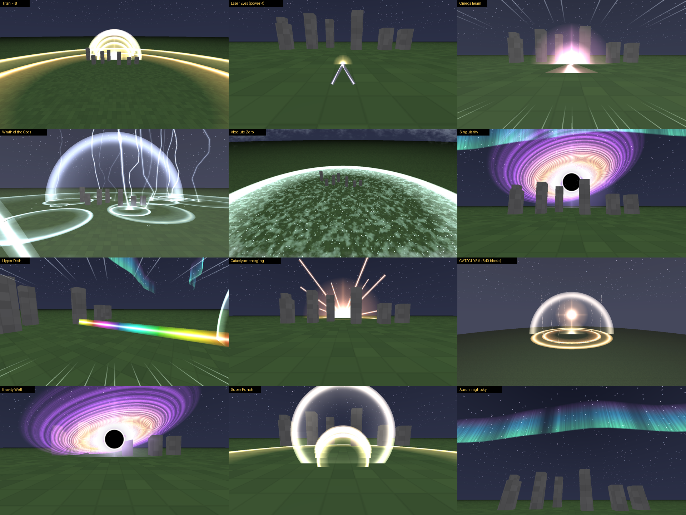

# Superpowers

A native mod for [Horizon](https://github.com/horizon-rust/horizon), the Rust rewrite of Minecraft: Java Edition
26.3. It adds twelve super powers, five of them mega powers, plus elytra-style **Superflight** with barrel rolls and
loops. On top of that there's the **CATACLYSM**, a crater 40 chunks across, along with a keybind panel and aurora night
skies. Built on Horizon commit `e57b1d3`, the build Orbital Laser pins, so the two run in one game, and for
launchers that read native mods as `horizon-mixin.toml` bundles.

*Drawn on a software GPU over a stand-in scene (the grass and stone pillars are fake) by this mod's effects as
they were first built for the newer mod API. This build draws the same effects with its own GPU pass, so the
look is close but not identical. In the game they draw over your world.*

## Powers

All keys can be rebound in Horizon's Controls, under **Superpowers**. **H** shows and hides the panel, which lists
every key, cooldown and the laser power.

| Key | Power | What it does |
| --- | --- | --- |
| **Z** | Super Punch | Shatters a cone of blocks 16 long. Debris flies, mobs are hurt and thrown, and a shockwave races across the ground. |
| **G** | Laser Eyes | Toggles the beams. **Each right-click raises the power from 1 to 5**, then wraps back to 1. They burn through blocks and set mobs alight. |
| **V** | Thunder Strike | Seven lightning bolts strike around your target. |
| **B** | Frost Nova | Water freezes, lava turns to obsidian and snow settles within 14 blocks. Mobs are frozen and slowed. |
| **N** | Gravity Well | A black hole pulls in mobs, items and torn-up blocks for 5 seconds, then implodes. |
| **J** | Hyper Dash | Launches you forward, with a rainbow trail and a sonic boom. |
| **R** | **Superflight** | Fly freely, steering with the mouse, as with an elytra but with no gliding (see below). |

### Mega powers (×5)

| Key | Power | What it does |
| --- | --- | --- |
| **Y** | Titan Fist | Super Punch ×5: a cone 80 blocks long and a shockwave 170 blocks out. |
| **U** | Omega Beam | Laser Eyes ×5: a giant beam that carves a tunnel 200 blocks long for 4 seconds, following your aim. |
| **I** | Wrath of the Gods | Thunder ×5: 36 bolts across a circle 92 blocks wide, each leaving a crater. |
| **O** | Absolute Zero | Frost ×5: freezes 70 blocks round you, raises ice spikes and adds a blizzard of frost. |
| **K** | Singularity | Gravity Well ×5: a black hole that pulls from 120 blocks away, eats a ball of land 48 blocks across, then explodes. |
| **M** (hold 2 s) | **CATACLYSM** | Hold to charge, aim where you look, and let it build. It blasts a crater **640 blocks (40 chunks) across** and up to 90 deep, wiping out everything in it. Let go early to call it off. |

## Superflight

| Control | Does |
| --- | --- |
| Mouse | Steers: you fly where you look. |
| W / S | Thrust and airbrake. |
| Sprint (Ctrl) + W | Boost (about 60 blocks a second). |
| A / D | Bank and slide sideways; turning banks you too. |
| Double-tap A or D | A full barrel roll that way, corkscrewing round your line of flight. |
| **X** | A loop: the camera and your flight go up, over and round. |
| Space / Sneak | Climb and sink. |
| R | Land (stop flying). |

You take no fall damage while flying, nor for ten seconds after. The view widens with speed, and speed lines stream
past when you boost. The camera rolls and loops all the way round: the mod carries one small patch to the game (the
`[[injection]]` in `horizon-mixin.toml`), because the game otherwise limits a mod's camera turn to 10 degrees.

> [!WARNING]
> **The powers change the world for good.** Use a throwaway world or back yours up. They never break bedrock or the
> bottom five layers of the world. The small powers only break blocks a tool can mine (plus plants, glass and wool);
> the Cataclysm wipes out everything in its crater. It only changes chunks that are loaded, so beyond your render
> distance the land stays as it was.

## Install

1. In the launcher's **Mods** page, remove any older **superpowers**.
2. Choose **Add from GitHub** and paste a commit link (`https://github.com/pressflowed/minecraft-mod/commit/<sha>`).
   The repository must be public.
3. Press **Build**, then **I trust these mods: build**. Native mods run unsandboxed; all of this one's code is in
   [`api/src`](api/src).
4. Play. Press **H** for the panel. Type `/time set midnight` to see the aurora.

## How it was checked

- The code type-checks against Horizon's own source at commit `e57b1d3`, the build it is made for, and its
  unit tests pass (the flight physics, the bolt scatter, the cast message, the key layout).
- The shaders pass wgpu's validator and translate for Vulkan, Metal and DirectX.
- It hasn't run inside the game yet. If the build fails, the Mods page and `native/build.log` say why. If something
  looks or feels wrong in play, it's quick to tune.

## Layout

| File | What |
| --- | --- |
| `horizon-mixin.toml` | The bundle: the pinned build, the `[api]` crate, and the camera patch. |
| `mixins/unbounded_shake.rs` | The camera patch. |
| `api/src/lib.rs` | The hooks. |
| `api/src/client.rs` | Every power's key and cooldown; effects, Superflight, camera feel and sounds. |
| `api/src/flight.rs` | Vector maths for flight. |
| `api/src/server.rs` | What each power does to the world, in each level's tick. |
| `api/src/render.rs`, `api/src/shader.rs` | The GPU passes and their WGSL. |
| `api/src/hud.rs` | The panel, the flight read-out and the Cataclysm's charge. |
