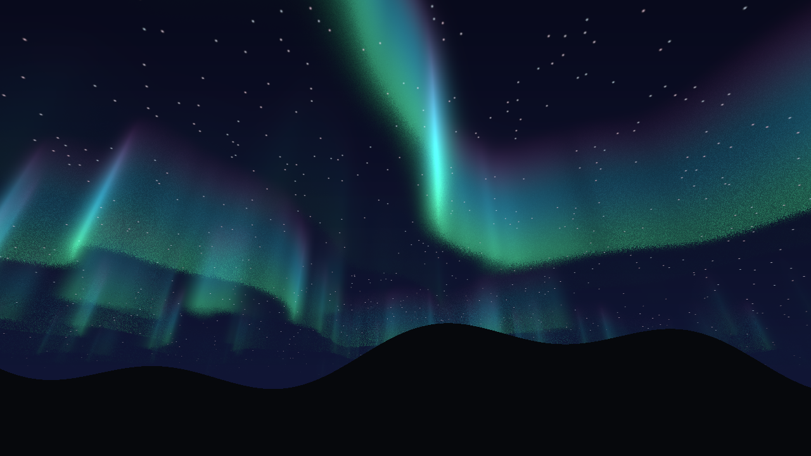

# Aurora Skies

A native mod for [Horizon](https://github.com/horizon-rust/horizon), the Rust rewrite of Minecraft: Java Edition
26.3. At night in the Overworld the sky gets:

- **Aurora curtains** that ripple and drift: green at the bottom edge, then cyan, fading to violet at the top, with
  light rays running through them.
- **Shooting stars** that streak across the sky every few seconds, each with a glowing head and a fading tail.
- **Twinkling stars** in soft blue and pink, added to the vanilla ones.

Everything is drawn by a custom GPU shader that runs right after the world is drawn, only on open sky. Hills,
trees, mobs and clouds stay in front of it. It fades in at dusk and out at dawn, and does nothing by day or in the
Nether and the End.

| Aurora over the hills | A shooting star overhead |
| --- | --- |
|  |  |

*These previews come from the mod's real drawing code running on a software GPU over a stand-in scene (the hills are
fake). In the game it draws over your own world.*

## Requirements

- The Horizon launcher (0.2.37 or newer) and an instance set up from your own Minecraft: Java Edition 26.3.
- This mod is pinned to Horizon commit `e57b1d34bb0dcf6bf081c19fe6d2e7f69b60cdf4`, the same one Orbital Laser
  pins, so the two build into one game.
- On Linux: a C compiler, `pkg-config`, and the ALSA and libudev development files (the launcher tells you the
  command if any are missing). Windows needs nothing extra.

## Install

1. **Close the game.**
2. In the launcher, open the **Mods** page and choose **Add from GitHub**. Paste this repository's link, or a link to
   one exact commit (`https://github.com/pressflowed/minecraft-mod/commit/<sha>`). The launcher reads GitHub
   without signing in, so **the repository must be public**.
3. On the **Native build of {instance}** row, press **Build**, read the warning, and choose
   **I trust these mods: build**. Native mods aren't sandboxed; this one only draws the sky (read
   [`api/src/lib.rs`](api/src/lib.rs) and [`api/src/shader.rs`](api/src/shader.rs)). The first build can take 20 to
   30 minutes; later ones are quicker.
4. Play. In a world, type `/time set midnight` and look up.

Command-line alternative:

```bash
horizon-launcher mods add-github https://github.com/pressflowed/minecraft-mod --instance "<instance>" --trust-native-code
```

```bash
horizon-launcher native-build --instance "<instance>" --trust-native-code
```

## If the build fails

The Mods page shows the error, and the launcher keeps the full output in the instance's `native/build.log`. The
mod's Rust code has been compiled against a stand-in for Horizon's mod API (the same hook signatures and the same
`wgpu` 30.0.1), and the shader passes wgpu's own validator (`naga`) for Vulkan and Metal. It hasn't yet been built
inside the real game, so if something doesn't compile, the build log says exactly what.

## How it works

- `horizon-mixin.toml`: the bundle. Its `[api]` package is a trait mod; it needs no injections, so the launcher
  skips horizon-mixins for it.
- `api/src/lib.rs`: `Hooks::tick` reads the time of day and the dimension from the game. The mod's `RenderHooks`
  asks for the world's depth (`render_needs`) and draws one full-screen pass in `world_drawn`, blended additively
  over the picture wherever the depth says "sky".
- `api/src/shader.rs`: the WGSL. Aurora curtains come from one 2D ribbon field sampled on 28 stacked planes, 220
  to 520 blocks above the camera, so the ribbons rise as vertical curtains. Shooting stars and extra stars live on
  the sky folded onto a plane overhead.
